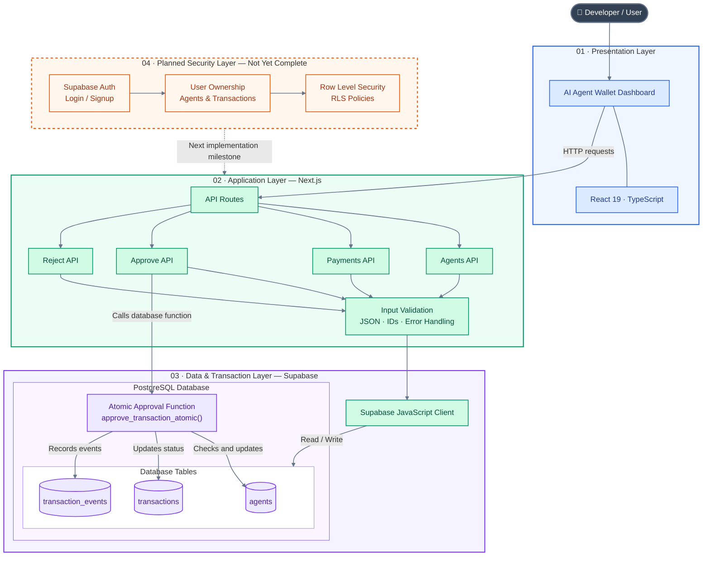

# AI Agent Wallet

**A controlled spending wallet for AI agents.**

AI agents are becoming capable of taking actions on our behalf, including buying API credits, using cloud services, and paying for digital tools. But giving an agent unrestricted access to a payment method can be risky.

AI Agent Wallet is an early-stage project exploring how to give an agent a limited budget, restrict where it can spend, and review or block payment requests before money is spent.

> **Project status:** Early prototype / in active development. This is not a production-ready wallet or payment service. Authentication, per-user data ownership, and a complete security review are still unfinished.

**Repository:** https://github.com/himanshu-learns/ai-agent-wallet

---

## At a glance

- **Problem:** AI agents may need to purchase tools or services, but unrestricted spending is hard to control and audit.
- **Approach:** Give each agent a wallet balance, a maximum amount per transaction, a daily spending limit, and an allowed-merchant list.
- **Main flow:** A payment request is checked against the configured rules. Eligible requests can be approved; requests that break a rule are rejected or blocked. The project also supports reviewing pending requests.
- **Who it may help:** Developers and teams building AI agents that need bounded access to paid APIs, cloud services, or other approved digital services.
- **Current stage:** Core wallet and transaction-control flows are being prototyped and tested. Secure multi-user access is the next major milestone.

## The problem I'm exploring

AI agents can make useful decisions, but real-world actions need limits. If an agent can spend without guardrails, a bug, a poorly formed request, or an unexpected sequence of actions could create unwanted costs.

Developers need answers to simple questions:

- How much money may this agent spend?
- What is the maximum it may spend in one transaction?
- How much may it spend in a day?
- Which merchants or services may it use?
- Can a human review a request before it is approved?
- Can we see why a request was approved, rejected, or blocked?

AI Agent Wallet is an attempt to make these controls explicit and testable.

## How it is intended to work

1. **Create an agent** and configure its wallet balance, daily limit, transaction limit, and allowed merchants.
2. **Submit a payment request** with a merchant and amount.
3. **Check the rules:** agent status, merchant allow-list, transaction limit, available balance, and daily spending limit.
4. **Make a decision:** reject a request that violates a rule, or allow an eligible request to proceed through the approval flow.
5. **Record the result** so the application can display transaction status and the reason for the decision.

The key idea is that spending rules should be enforced on the server/database side, not only in the user interface.

## Features implemented or prototyped

- Agent dashboard with wallet balance and spending information.
- Agent configuration for balance, per-transaction limit, daily limit, active status, and allowed merchants.
- Payment request and transaction history flows.
- Approve and reject actions for transactions.
- Server-side validation for malformed JSON and invalid transaction IDs in approve/reject API routes.
- Atomic database approval function that locks the transaction and agent rows, checks important spending rules, updates the balance and daily spending, updates the transaction status, and writes an event to `transaction_events`.
- Merchant allow-list and transaction-limit checks in the atomic approval function.
- Database constraint requiring transaction amounts to be greater than zero.
- Basic build and API input-validation checks have been run during development.

These features are still part of an evolving prototype; they have not been independently audited or certified for handling real funds.

## Technology stack

| Area | Technology | Purpose |
|---|---|---|
| Frontend | Next.js 16, React 19, TypeScript | Dashboard and application/API routes |
| Styling | Tailwind CSS 4 | UI styling |
| Database | Supabase PostgreSQL | Agents, transactions, spending limits, and event records |
| Backend access | Supabase JavaScript client | Read and write application data |
| Transaction safety | PostgreSQL / PL/pgSQL RPC function | Perform approval checks and balance/status updates atomically |
| Authentication (in progress) | Supabase Auth and `@supabase/ssr` | Planned sign-in and server-side session handling |

The repository also contains Prisma-related dependencies/configuration, but the wallet's current data access and atomic approval flow use Supabase/PostgreSQL.

## Architecture Overview

AI Agent Wallet follows a layered architecture: the user interacts with a Next.js dashboard, API routes handle requests, and Supabase/PostgreSQL stores data and enforces critical payment approval rules.



### How to read this architecture

| Layer | Responsibility |
|---|---|
| Presentation | Displays agent balances, spending limits, payment requests, and transaction status. |
| Application | Next.js API routes process agent, payment, approval, and rejection requests. |
| Data access | The Supabase client connects application code to PostgreSQL. |
| Transaction safety | The atomic approval function checks spending rules and coordinates transaction and balance updates. |
| Planned security | Authentication, verified data ownership, and RLS need to be completed before production use. |

### Important database relationships

- `agents` stores agent configuration, balance, spending limits, allowed merchants, and API keys.
- `transactions.agent_id` references `agents.id`, connecting each transaction to its agent.
- `transaction_events` records approval success and failure events.
- The atomic approval function uses database row locks to help prevent conflicting concurrent approvals.

> **Current status:** The core wallet prototype and atomic approval flow have been implemented and tested along selected paths. Login/signup, per-user ownership, and complete API authorization are not yet finished. The planned security layer in this diagram represents future work, not existing protection.

## Local development

### Prerequisites

- Node.js and npm
- A Supabase project
- Access to the repository

### Setup

```bash
git clone https://github.com/himanshu-learns/ai-agent-wallet.git
cd ai-agent-wallet/frontend
npm install
```

Create `frontend/.env.local` with the public Supabase project URL and publishable key:

```env
NEXT_PUBLIC_SUPABASE_URL=https://YOUR_PROJECT.supabase.co
NEXT_PUBLIC_SUPABASE_PUBLISHABLE_KEY=YOUR_SUPABASE_PUBLISHABLE_KEY
```

Replace the placeholders with values from your own Supabase project. Do not commit `.env.local`, database passwords, service-role keys, or other secrets.

Start the development server:

```bash
npm run dev
```

Then open the local URL printed by Next.js, usually `http://localhost:3000`.

> **Database setup:** The application expects the required Supabase tables, the `approve_transaction_atomic` database function, and the transaction amount constraint to exist. Review the SQL migrations under `supabase/migrations` and apply them to your own project deliberately. Do not run migrations against a database containing data you cannot restore.

## Validation performed so far

During development, the following checks have succeeded:

- `npm run build`
- `npx tsc --noEmit`
- `git diff --check`
- Approve/reject API checks for invalid IDs, malformed JSON, and nonexistent transaction IDs
- A rollback-wrapped database test confirming the atomic approval function rejects a payment that exceeds the agent's transaction limit
- Verification that the database rejects zero and negative transaction amounts

These checks validate specific development paths; they are not a full security, concurrency, or end-to-end test suite.

## Current development status

### Completed / verified

- Core agent and transaction dashboard flows exist.
- Approve/reject API input validation and error handling have been added.
- Atomic approval logic checks the agent's active status, merchant allow-list, transaction limit, available balance, and daily limit.
- Approval logic updates balance, daily spending, and transaction status within the database function and records success/failure events.
- A positive-amount database constraint is installed and verified.
- A production build and several targeted validation checks passed.

### In progress / not complete

- Supabase Auth email provider is enabled in the Supabase project.
- A Supabase browser client, server client, and Next.js `proxy.ts` session-refresh setup have been started locally.
- **Login/signup has not been completed or verified.**
- **Sensitive API routes are not yet fully protected by authenticated-user checks.**
- **Per-user ownership has not been implemented.** The current `agents` table has no `user_id`; transactions connect to agents through `agent_id` only.
- Existing database data includes 2 agents and 13 transactions, but their real owner has not been confirmed. These records must not be assigned to a user by guesswork.
- A safe, restorable database backup/export has not yet been completed.

### Known security work before any real use

- Require and verify a valid Supabase session on every sensitive API route.
- Add a verified ownership model for agents and ensure transactions are accessible only through an agent owned by the signed-in user.
- Review and configure PostgreSQL Row Level Security (RLS) policies and database privileges.
- Stop exposing agent `api_key` values in ordinary dashboard/API responses; rotate any keys that should be treated as secrets.
- Ensure secrets and database credentials are never exposed to browser code or committed to Git.
- Add tests for unauthenticated access, cross-user access, race conditions, limit enforcement, and balance consistency.
- Review authorization for the database RPC function and its grants before production use.

**Until these items are completed and reviewed, use only test data and do not connect real payment methods or real funds.**

## Roadmap

1. Finish Supabase Auth sign-up, sign-in, sign-out, and session handling.
2. Create a safe ownership migration plan for existing records; preserve and quarantine records whose owner is unknown.
3. Protect all sensitive API routes with server-side authentication and ownership checks.
4. Configure RLS and least-privilege database access; remove secret API keys from public responses.
5. Build an automated test suite for approval rules, concurrency, invalid requests, and cross-user access.
6. Improve the interface with clear explanations for blocked/approved requests and an audit timeline.
7. Add product validation with developers building AI agents: learn which spending controls they need most and whether this workflow solves a real, frequent problem.
8. Consider future capabilities such as budgets by project, alerts, configurable approval policies, spend analytics, key rotation, and integrations with agent frameworks—only after the core safety model is reliable.

## Product direction

The long-term direction is to explore a **spending-control layer for AI agents**: a developer should be able to grant an agent limited permission to spend, restrict where it can spend, inspect each decision, and revoke access when needed.

The prototype is an experiment toward that direction, not yet evidence that the product is production-ready or that market demand has been validated.

## Contributing / feedback

Feedback is welcome, especially from developers building AI agents that interact with paid APIs or cloud services. Helpful feedback includes which spending controls are essential, where human approval is necessary, and what would make this useful in a real workflow.

## Disclaimer

This project is an experimental software prototype for learning and product validation. It is not a bank, payment processor, financial account, or production-grade security product. Do not use it to manage real money or production credentials.
